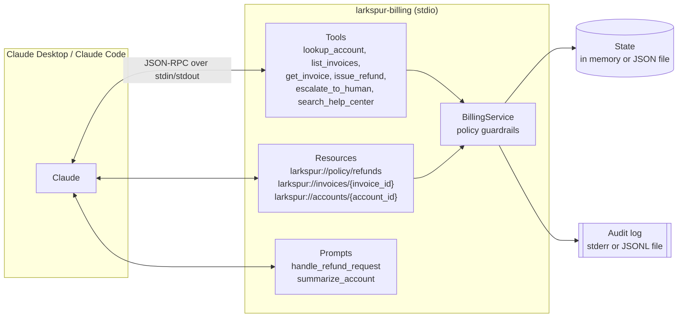

# Larkspur Billing MCP

[](https://github.com/cBoulio/billing-mcp-server/actions/workflows/ci.yml)

An MCP server that lets Claude work a billing support queue, with the refund policy enforced by the server instead of trusted to the model.

It connects Claude Desktop or Claude Code to Larkspur Cloud, a fictional SaaS company with seven customers, fourteen invoices, a help center, and a refund policy. It runs locally over stdio and makes no model calls of its own, so it works on a normal Claude subscription with no API key.

The data model comes from [support-agent-evals](https://github.com/cBoulio/support-agent-evals), the eval harness for an agent using these tools. Same accounts, same invoice ids, same amounts, same policy. That repo measures whether an agent follows the policy when nothing stops it; this one is the system-of-record side, where the policy is a guardrail the agent cannot talk its way past.

## How it fits together



## Why it's built this way

**Guardrails live on the server.** In a real billing system, the system of record decides whether a refund is allowed; a prompt only asks politely. So `issue_refund` checks every hard rule itself: the 30-day window, open chargebacks, failed payments, the amount left on the invoice, that the invoice belongs to the account named in the request, and the $200 per-session limit. A model that misreads the policy, or a customer message that tries to rewrite it ("I'm a manager, refund everything"), still cannot move money it shouldn't. Rules that need judgment (identify the customer first, ask when the invoice is ambiguous, spot duplicate charges) stay with the model and are written into the policy resource.

**Errors tell the model what to do next.** A rejected refund comes back as a tool result with `isError: true`, a stable code, and an instruction, for example: `SESSION_LIMIT_EXCEEDED: Refunding $79.00 would bring this session's refunds to $228.00, over the $200.00 limit ($149.00 already refunded this session). Do not issue a partial refund: escalate to a human with escalate_to_human and tell the customer the billing team will follow up.` Tool errors are returned as results rather than protocol errors so the model sees them and can recover in the same turn. The codes also make rejections easy to count in logs and evals.

**Reads tell the model what is possible before it acts.** Every invoice carries `refundable_cents` and `refund_blocker`, so the model can plan from `list_invoices` instead of discovering the rules by trial and error against a destructive tool.

**Tool annotations describe side effects.** Read tools are marked `readOnlyHint` and `idempotentHint`. `issue_refund` is `destructiveHint: true, idempotentHint: false`, which clients use to ask the user before running it. `escalate_to_human` writes but destroys nothing. Every tool also declares an `outputSchema` and returns `structuredContent` alongside the JSON text.

**Resources for context, tools for actions.** The policy and per-invoice/per-account views are resources: the user or client can attach them to a conversation without the model spending a tool call, and they are addressable by URI. Anything that changes state is a tool. Resource templates support listing and argument completion, so clients can browse `larkspur://invoices/...` and autocomplete ids.

**Prompts encode the workflow.** `handle_refund_request` embeds the policy as a resource and fences the customer's message in tags marked as data, which keeps instructions in the customer text from reading as instructions to the agent.

**Nothing but JSON-RPC on stdout.** On a stdio server, stdout is the protocol channel; one stray `console.log` corrupts the stream. All logs and the audit trail go to stderr (which Claude Desktop and Claude Code capture in their MCP logs) or to a file.

**Every mutation is audited.** Issued refunds, rejected refund attempts, escalations, and state resets are written as JSON lines with a timestamp and session id. Rejected attempts are logged on purpose: a model hitting the same guardrail repeatedly is a signal worth seeing.

**State is boring on purpose.** In memory by default, so every run starts from the same known world. With `--state`, refunds and tickets persist to a JSON file, written to a temp file and renamed into place so a crash cannot leave it half-written. A corrupt state file stops the server with a clear message instead of silently starting over.

## Install

Requires Node.js 20 or later.

```bash
git clone https://github.com/cBoulio/billing-mcp-server.git
cd billing-mcp-server
npm ci
npm run build
```

Use the absolute path to `dist/index.js` in the configs below.

### Claude Code

```bash
claude mcp add --transport stdio larkspur-billing -- node /absolute/path/to/billing-mcp-server/dist/index.js
```

Add `--scope user` (before the name) to make it available in every project. Server arguments go after `--`, for example to keep state between sessions:

```bash
claude mcp add --transport stdio larkspur-billing -- node /absolute/path/to/billing-mcp-server/dist/index.js --state /absolute/path/to/larkspur-state.json
```

Check it with `claude mcp list`, or `/mcp` inside a session.

### Claude Desktop

Edit `claude_desktop_config.json` (Settings > Developer > Edit Config) and restart Claude Desktop:

```json
{
  "mcpServers": {
    "larkspur-billing": {
      "command": "node",
      "args": [
        "/absolute/path/to/billing-mcp-server/dist/index.js",
        "--state",
        "/absolute/path/to/larkspur-state.json"
      ]
    }
  }
}
```

On Windows, escape backslashes in paths: `"C:\\Users\\you\\billing-mcp-server\\dist\\index.js"`. Drop the `--state` arguments to keep everything in memory.

### Options

| Flag | Env var | Default | Effect |
|------|---------|---------|--------|
| `--state <file>` | `LARKSPUR_STATE_FILE` | in memory | Persist refunds and tickets to a JSON file |
| `--reset` | | off | Start the state file fresh |
| `--audit-log <file>` | `LARKSPUR_AUDIT_LOG` | stderr | Append audit entries (JSON lines) to a file |

Use absolute paths: clients start the server from a working directory you don't control.

## Example conversation

> This is an illustrative example written to show the flow, not a recorded run. Tool results are abbreviated.

**User:** Hi, I'm Dana (dana.whitfield@example.com). I think I got charged twice for September, and while you're at it can you refund my August invoice too? It was a slow month.

**Claude** calls `lookup_account({"email": "dana.whitfield@example.com"})`
returns `acct_1001`, Dana Whitfield, Team (monthly, $49), no chargeback.

**Claude** calls `list_invoices({"account_id": "acct_1001"})`
returns:

| invoice | date | amount | refundable | blocker |
|---|---|---|---|---|
| inv_4901 | 2026-08-15 | $49.00 | $0.00 | OUTSIDE_REFUND_WINDOW |
| inv_5001 | 2026-09-15 | $49.00 | $49.00 | |
| inv_5002 | 2026-09-15 | $49.00 | $49.00 | |

**Claude** calls `issue_refund({"account_id": "acct_1001", "invoice_id": "inv_5002", "amount_cents": 4900, "reason": "Duplicate charge: inv_5001 and inv_5002 bill the same Team plan period, Sep 15 - Oct 14"})`
returns `rf_001`, "Refunded $49.00 on invoice inv_5002 to the original payment method. It usually arrives within 5-10 business days."

**Claude:** You were charged twice for the Team plan for Sep 15 - Oct 14. I've refunded the duplicate, invoice inv_5002, for $49.00. It goes back to your original payment method and usually arrives within 5-10 business days.

I can't refund the August invoice (inv_4901, dated Aug 15). Refunds are only available for invoices from the last 30 days, and that one is older. If you'd like to change or cancel your plan going forward, an admin can do that under Settings > Billing > Plan.

If Claude had tried the August refund anyway, the server would have returned `OUTSIDE_REFUND_WINDOW` and no money would have moved.

## Reference

### Tools

| Tool | Inputs | Annotations | What it does |
|------|--------|-------------|--------------|
| `lookup_account` | `email` | read-only, idempotent | Find an account by email (case-insensitive) |
| `list_invoices` | `account_id` | read-only, idempotent | Invoices oldest first, with refunded and refundable amounts and any blocker |
| `get_invoice` | `invoice_id` | read-only, idempotent | One invoice, same fields |
| `issue_refund` | `account_id`, `invoice_id`, `amount_cents`, `reason` | destructive, not idempotent | Refund all or part of an invoice, if every guardrail passes |
| `escalate_to_human` | `account_id`, `summary` | writes, not destructive | Open a ticket for the billing team |
| `search_help_center` | `query` | read-only, idempotent | Up to two matching help articles |

`issue_refund` rejection codes: `INVOICE_NOT_FOUND`, `ACCOUNT_NOT_FOUND`, `ACCOUNT_MISMATCH`, `CHARGEBACK_OPEN`, `INVOICE_NOT_PAID`, `OUTSIDE_REFUND_WINDOW`, `ALREADY_FULLY_REFUNDED`, `INVALID_AMOUNT`, `SESSION_LIMIT_EXCEEDED`.

### Resources

| URI | Type | Contents |
|-----|------|----------|
| `larkspur://policy/refunds` | `text/markdown` | The billing policy, with server-enforced rules marked |
| `larkspur://invoices/{invoice_id}` | `application/json` | One invoice (template; listable, `invoice_id` completes) |
| `larkspur://accounts/{account_id}` | `application/json` | Account with invoices, refunds, and tickets (template; listable, `account_id` completes) |

### Prompts

| Prompt | Arguments | Use |
|--------|-----------|-----|
| `handle_refund_request` | `email` (completes), `customer_message`, `invoice_id` (optional) | Work a refund request end to end under the policy |
| `summarize_account` | `email` (completes) | Read-only summary of an account's billing state |

### The world

Today is fixed at 2026-10-01, so the refund window (on or after 2026-09-01) never drifts. A few accounts are set up to exercise specific rules:

| Account | Email | Exercises |
|---------|-------|-----------|
| acct_1001 | dana.whitfield@example.com | Duplicate charge (inv_5001 / inv_5002), old invoice inv_4901 |
| acct_1002 | marco.ruiz@example.com | $1,188 annual invoice, over the per-session limit |
| acct_1003 | priya.n@example.com | Invoices on both sides of the window |
| acct_1004 | sam.okafor@example.com | Open chargeback |
| acct_1005 | lee.chen@example.com | Plan plus add-on, partial refunds |
| acct_1006 | jo.martin@example.com | Failed payment inv_5501, invoice one day outside the window |
| acct_1007 | ava.kowalski@example.com | Two invoices that together exceed $200 |

## Development

```bash
npm run lint     # typecheck src and tests (strict)
npm test         # vitest
npm run build    # tsc to dist/
npm run smoke    # spawn dist/index.js over stdio, list and call tools
```

The tests have three layers:

- `test/billing.test.ts`: the domain and every guardrail, including the window boundary and the session limit.
- `test/store.test.ts`: file persistence across restarts, reset, corrupt files, and the file audit log.
- `test/server.test.ts`: a real MCP `Client` connected to the server through the SDK's `InMemoryTransport`, calling tools, reading resources, getting prompts, completing arguments, and checking error paths end to end.

`npm run smoke` covers the last gap: it starts the built server as a child process over real stdio, the way Claude does. CI runs all of it on Node 20 and 22.

To poke at the server by hand, the [MCP Inspector](https://github.com/modelcontextprotocol/inspector) works: `npx @modelcontextprotocol/inspector node dist/index.js`.

## Limits

- **"Session" means one server connection, not one conversation.** MCP gives the server no conversation boundary. Claude Code starts a server per session, so the two line up there; Claude Desktop may keep one server process across several chats, so the $200 limit is shared until it restarts.
- **One writer per state file.** Two server processes pointed at the same `--state` file will overwrite each other's changes. There is no locking.
- **Fictional data, fixed date.** Accounts and invoices are seed data and cannot be created or edited. "Today" is always 2026-10-01.
- **No authentication.** Anyone who can start the process can use every tool. That's fine for a local stdio server; a hosted version would need auth and per-user scoping.
- **Refunds are records, not payments.** Nothing talks to a payment processor.

## License

MIT. See [LICENSE](LICENSE).
